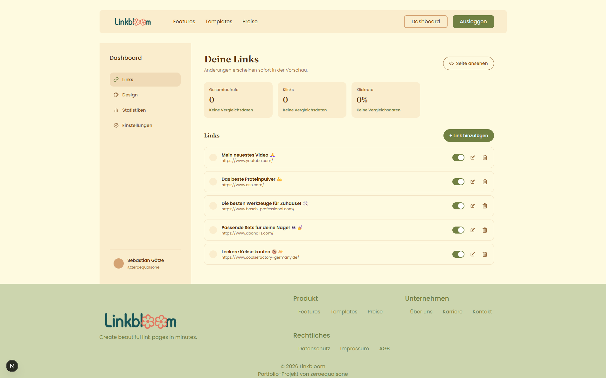
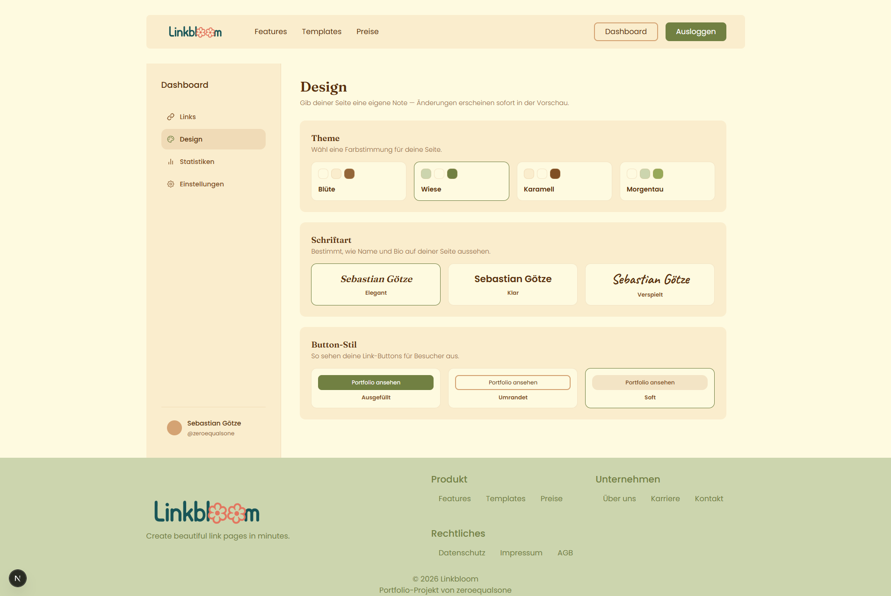
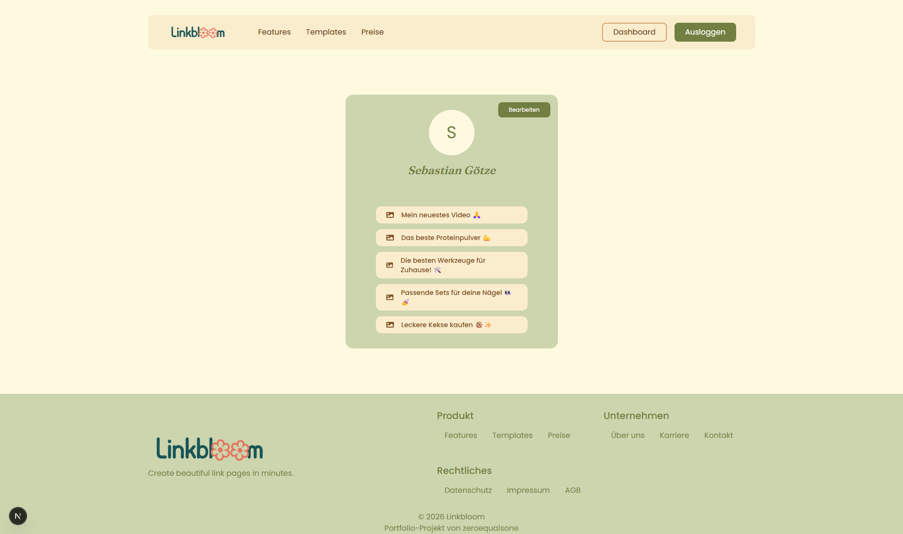

# Linkbloom 🌱

**Linkbloom** ist eine Fullstack Link-in-Bio-Plattform auf Basis von Next.js (App Router) und Supabase. Nutzer erstellen ein Konto, verwalten ihre Links, passen das Design ihres öffentlichen Profils an und teilen eine URL.

<p>
  
  
  
  
  
  
</p>

## Live Demo

<a href="https://linkbloom-two.vercel.app/">Linkbloom 🌱</a> · <a href="https://linkbloom-two.vercel.app/zeroequalsone">Beispielprofil</a>

## Screenshots

<p align="center">
  
  
  
</p>
<p align="center"><em>Link-Dashboard · Design-Einstellungen · Öffentliches Profil</em></p>

## Über das Projekt

Ich habe Linkbloom gebaut, um über reine Frontend-Arbeit hinauszugehen und echte Erfahrung mit Auth, Datenbankdesign und dem Synchronhalten von Dashboard und öffentlicher Seite zu sammeln, ohne die Komponenten- und UI-Arbeit zu vernachlässigen, die weiterhin mein Schwerpunkt ist.

## Highlights

- **Authentifizierung**: Registrieren, Einloggen, Ausloggen über Supabase Auth (Client- und Server-seitig). Nutzername, E-Mail und Passwort sind im Einstellungs-Dashboard änderbar. Beim Löschen des Kontos werden Profil, Links und Statistiken entfernt.
- **Link-Verwaltung**: Links erstellen, bearbeiten, löschen und per Toggle aktivieren oder deaktivieren. Der zuletzt erstellte Link steht oben, manuelles Umsortieren gibt es noch nicht.
- **Öffentliches Profil** (`/<username>`): Für jeden sichtbar, auch ohne Login. Es zeigt maximal 5 aktive Links (die Begrenzung gilt nur in der Anzeige, nicht beim Erstellen).
- **Sichtbarkeit**: Das Profil lässt sich im Dashboard öffentlich oder nicht öffentlich schalten, unabhängig davon, welche Links aktiv sind. Nicht öffentliche Profile werden nicht gefunden (404).
- **Design-Anpassung**: Farbthema, Schriftart und Button-Stil für das öffentliche Profil. Änderungen werden sofort gespeichert und beim nächsten Laden der Profilseite sichtbar. Eine Live-Vorschau im Dashboard gibt es noch nicht.
- **Bearbeiten-Button**: Nur der eingeloggte Besitzer sieht auf seinem eigenen Profil einen Button zurück ins Dashboard.
- **Fehlerseiten**: Eigene 404-Seite und Error-Boundary im Stil der App.
- **Analytics** _(in Arbeit)_: Die Berechnungslogik für Aufrufe und Klickrate ist implementiert, das Klick-Tracking selbst noch nicht. Geplant ist eine Deduplizierung pro Besucher über Browser-Speicher statt IP-Tracking, um Datenschutz-Abwägungen der IP-Speicherung zu vermeiden. Die Zahlen auf der Login- und Registrierungsseite sind Platzhalter.

## Sicherheit und Datenbank

Das Schema liegt in [`supabase/schema.sql`](./supabase/schema.sql): Tabellen, Constraints, RLS-Policies, Trigger und Funktionsrechte. Die Datei ist aus dem Live-Projekt rekonstruiert und dokumentiert den Ist-Zustand, sie ist keine Migration.

- **Row Level Security** ist auf allen Tabellen aktiv. Schreibzugriffe sind auf den eigenen Datensatz beschränkt (`auth.uid() = user_id`).
- **Lesezugriff** wird in der Datenbank durchgesetzt, nicht nur in der UI: Profile sind nur lesbar, wenn sie öffentlich sind (oder dem eingeloggten Nutzer gehören). Fremde Links sind nur lesbar, wenn sie aktiv sind und zu einem öffentlichen Profil gehören.
- **Profil und Statistiken** werden per Datenbank-Trigger bei der Registrierung angelegt.
- **Server-only Prüfungen** (E-Mail oder Nutzername schon vergeben) laufen über den Service-Role-Client. Die Funktion `check_email_exists` ist für `anon` und `authenticated` gesperrt, damit niemand Konten per API durchprobieren kann.

## Projektstruktur

- `app/`: Seiten und Routen (Landing, Login/Registrierung, Dashboard, `[username]` für das öffentliche Profil)
- `components/`: UI-Komponenten, gruppiert nach Bereich (`(dashboard)`, `auth`, `modals`, `ui`)
- `lib/`: Server Actions (Auth, Links, Profil), Supabase-Clients, Validierung
- `supabase/`: Datenbankschema und Policies

## Tech-Stack

- **Framework**: Next.js (App Router, Server- und Client-Komponenten, Server Actions) + React
- **Sprache**: TypeScript
- **Backend**: Supabase (Auth und Postgres mit Row Level Security)
- **Styling**: Tailwind CSS
- **UI**: react-icons, SVGR
- **Deployment**: Vercel (automatisches Deployment vom `main`-Branch, Preview-Builds pro Branch)

## Roadmap

- [ ] Klick-Tracking für Analytics
- [ ] Links per Drag & Drop umsortieren
- [ ] Live-Vorschau des Designs im Dashboard
- [ ] Tests und CI (Lint, Build) mit GitHub Actions
- [ ] Accessibility-Verbesserungen (Toggles und Modal-Buttons per Tastatur bedienbar)

## Lokal starten

### Voraussetzungen

- Node.js und npm
- Ein eigenes Supabase-Projekt

### Setup

```bash
git clone https://github.com/zeroequalsone/linkbloom.git
cd linkbloom
npm install
```

1. Im Supabase-Projekt den Inhalt von `supabase/schema.sql` im SQL Editor ausführen.
2. Eine Datei `.env.local` im Projekt-Root anlegen. Die benötigten Variablen stehen in `.env.local.example`.

```bash
npm run dev
```

Dann im Browser öffnen: `http://localhost:3000`

### Weitere Befehle

```bash
npm run lint       # ESLint
npm run build      # Produktions-Build
```

## Workflow

- Conventional Commits
- Ein Zweck pro Branch, gemerged via Squash and Merge
- Supabase-GitHub-Integration und Vercel-Preview-Builds prüfen jeden Branch vor dem Merge

## Herausforderungen und was ich gelernt habe

- **Supabase Auth, Client und Server-seitig**: Erste Nutzung von Supabase überhaupt. Die meisten Tutorials behandeln nur Client-seitige Flows, meine App brauchte aber auch Server-seitige Auth. Ich habe mich durch die Dokumentation gearbeitet und KI als Lernhilfe genutzt, um zu verstehen, _warum_ etwas funktioniert, statt Code zu kopieren.
- **Sicherheit gehört in die Datenbank**: Filter in meinem App-Code (`.eq("enabled", true)`) schützen nichts, weil der Anon-Key im Client-Bundle steckt und jeder die Supabase-API direkt aufrufen kann. Beim Prüfen mit `curl` habe ich gesehen, dass nicht öffentliche Profile lesbar waren. Seitdem setzen RLS-Policies die Sichtbarkeit durch.

## Über mich

Ich bin Sebastian Götze, Junior Frontend Developer. Linkbloom ist eines von mehreren Portfolio-Projekten, die unterschiedliche Seiten meiner Arbeit zeigen: Dieses hier ist Fullstack-fokussiert, während mein Projekt **Orbit** stärker datengetrieben ist und auf selbst zusammengestellten Datensätzen aufbaut.

- 🌐 [Mein Portfolio ansehen](https://sgoetze.vercel.app/)
